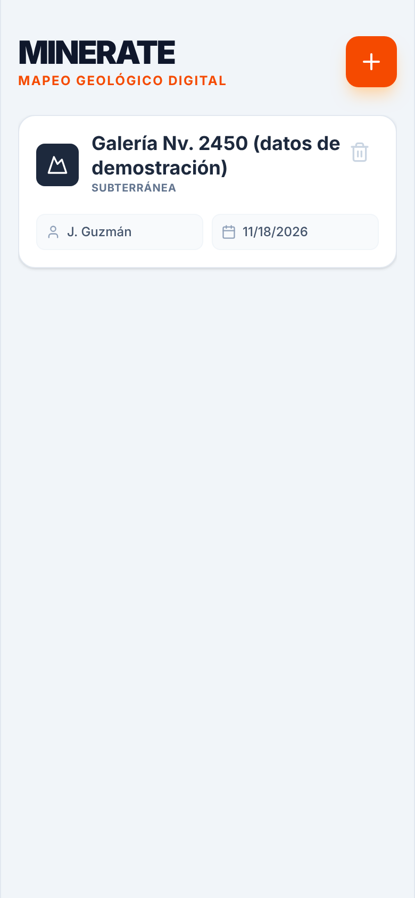
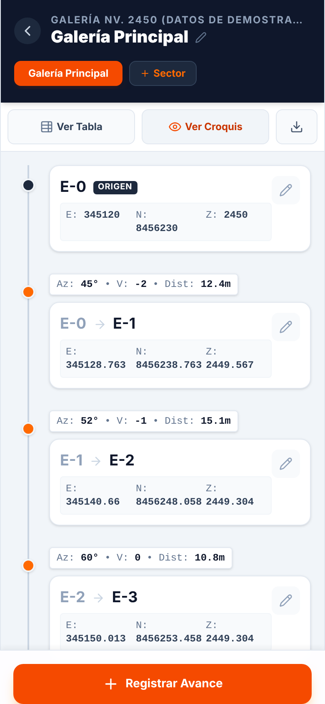
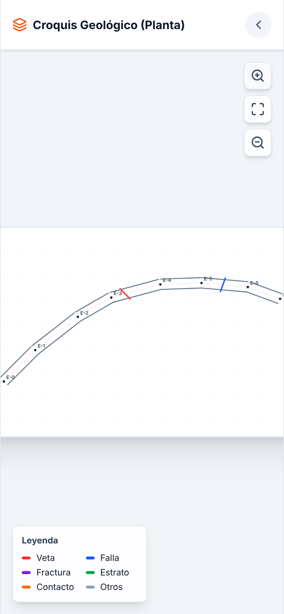

# Minerate · Mapeo topográfico y geológico de labores mineras

App web para registrar en campo el levantamiento topográfico con brújula y cinta de galerías, chimeneas y labores superficiales. Calcula las coordenadas de cada estación, dibuja el croquis en planta con las estructuras geológicas y funciona sin conexión.

Diseñada por un ingeniero de minas para reemplazar la libreta de campo y el traspaso manual a Excel o AutoCAD.

| Proyectos | Estaciones y avances | Croquis geológico |
| --- | --- | --- |
|  |  |  |

*Capturas con datos de demostración.*

## Qué hace

- **Proyectos y sectores:** cada proyecto (labor subterránea o superficial) se divide en sectores, como galerías o chimeneas, que pueden partir de una estación del sector principal.
- **Poligonal con brújula y cinta:** con cada avance se registran azimut, inclinación y distancia, y la app calcula este, norte y cota de la nueva estación.
- **Secciones de la labor:** distancias a izquierda, derecha, techo y piso, también en puntos intermedios del tramo.
- **Estructuras geológicas:** vetas, fallas, fracturas, estratos y contactos, con rumbo y buzamiento, ubicados sobre la labor.
- **Croquis en planta** con zoom y leyenda, y **vista de tabla** con todos los datos.
- **Exportación a CSV** de las estaciones para llevarlas a Excel, AutoCAD u otro software.
- **Sin conexión:** los datos se guardan en el dispositivo (IndexedDB) y la app lleva la cuenta de los cambios pendientes de sincronizar.
- **Asistente de IA (opcional):** reescribe las notas de campo como una observación geológica clara, con la API de Gemini.

## Cálculo de coordenadas

Para cada tramo, la distancia inclinada `d` se proyecta con el azimut `Az` y la inclinación `i`:

```
dH = d · cos(i)
ΔE = dH · sen(Az)      ΔN = dH · cos(Az)      ΔZ = d · sen(i)
```

Las coordenadas de la nueva estación se obtienen sumando estos incrementos a la estación anterior.

## Tecnologías

React 19 · TypeScript · Vite · Dexie (IndexedDB) · Tailwind CSS · Gemini API

## Cómo ejecutarlo

Requisitos: Node.js 18 o superior.

```bash
git clone https://github.com/josuega96/minerate.git
cd minerate
npm install
npm run dev
```

Para usar el asistente de IA, crea un archivo `.env.local` con tu propia clave:

```
GEMINI_API_KEY=tu_clave
```

Sin clave, la app funciona igual; solo se desactiva la mejora de notas.

## Estructura

```
components/   Vistas: proyectos, estaciones, formularios, croquis, tabla
services/     Base de datos local (Dexie), sincronización y cliente de Gemini
types.ts      Modelo de datos: proyecto, sector, estación, tramo, estructura
```

## Siguientes pasos

- Conectar la sincronización a un servidor real (hoy la subida está simulada).
- Exportar el croquis a DXF para abrirlo directamente en AutoCAD.

## Autor

Josué Guzmán Arpasi · Ingeniero de Minas (CIP 409126) · [GitHub](https://github.com/josuega96)
